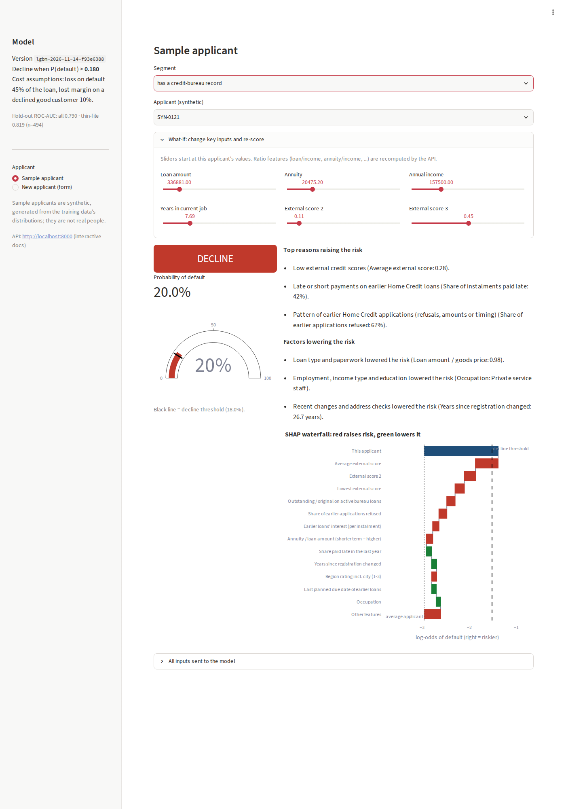
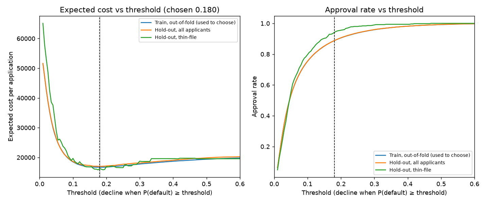
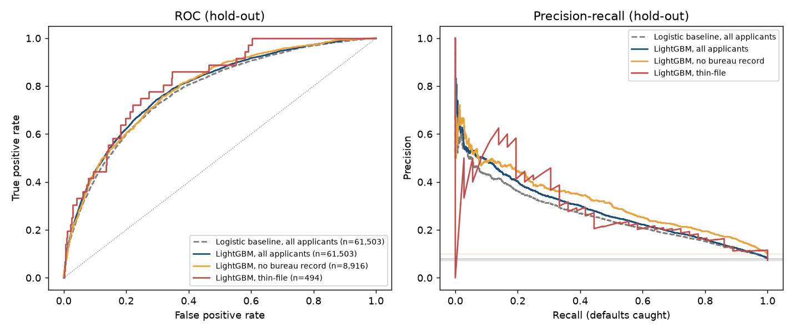
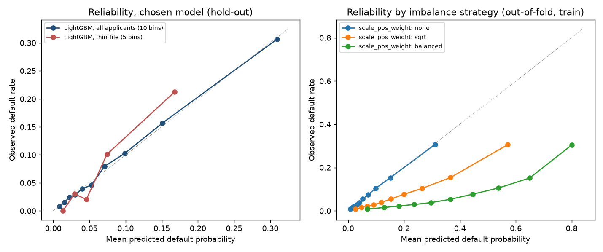
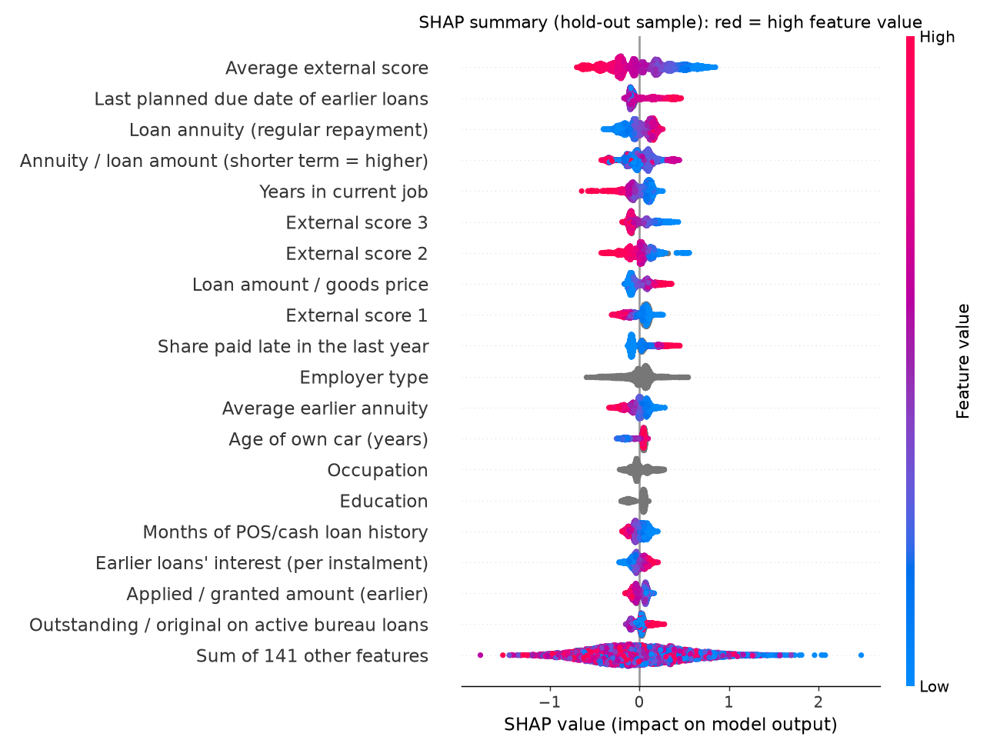
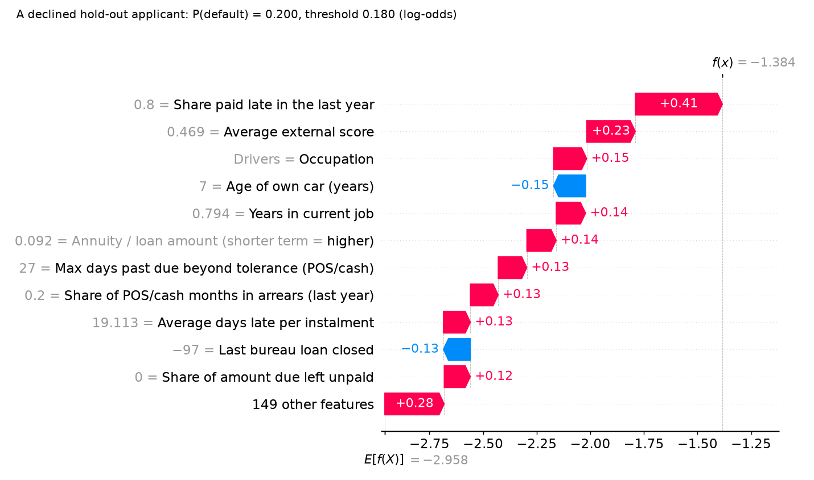
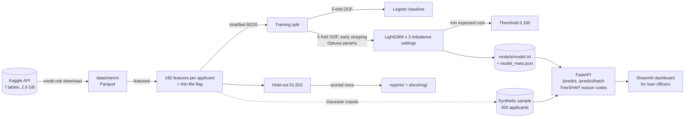
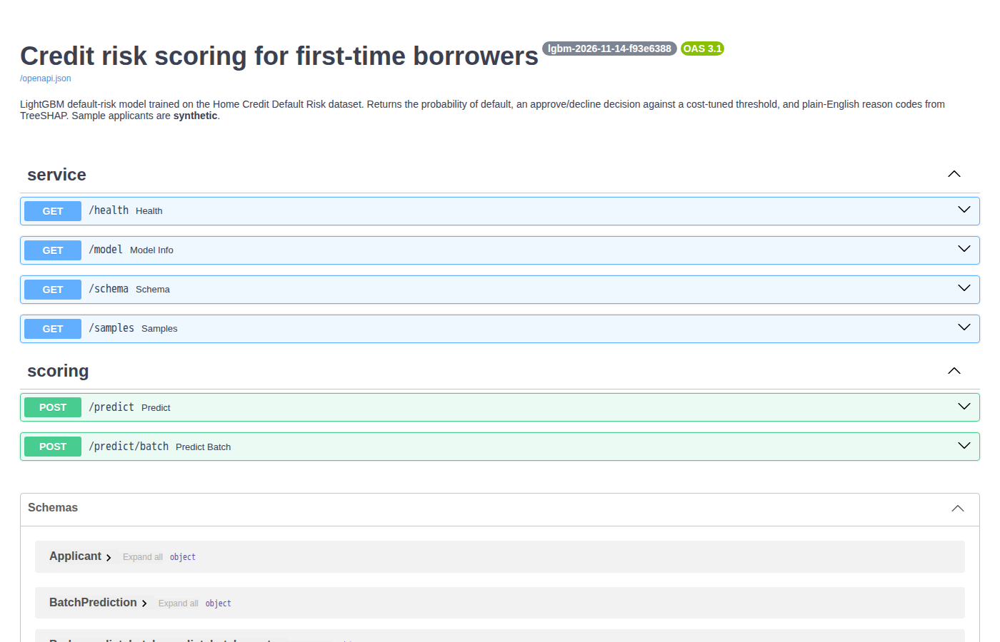

# Credit risk scoring for first-time borrowers

A loan-default model trained on 307,511 real applications from the Home Credit Default Risk dataset,
with an approval threshold tuned against the cost of bad loans versus rejected good customers,
plain-English SHAP reason codes for every decision, a FastAPI service and a Streamlit dashboard for loan officers.



<sub>Screenshot of the running app (`docker compose up`). The applicant shown is **synthetic** (see [Data](#data)).</sub>

## What it does

- **Features from three kinds of history.** A reusable pipeline (`src/credit_risk/features/`) turns 7 tables (58M rows) into 160 per-applicant features: credit-bureau history with other lenders (loan counts, recency, outstanding debt, card utilisation, months paid late), previous Home Credit applications (refusal rate, amounts applied for vs granted, recency) and repayment records (late-payment rate, underpayment ratio, missed instalments, card payments below the minimum), plus affordability ratios.
- **Imbalance and threshold.** About 8% of loans default. Three `scale_pos_weight` settings are compared out-of-fold, and the approval threshold minimises expected cost: a defaulted loan loses 45% of its amount and a declined good customer costs 10% of it in lost margin. Both figures are assumptions you can configure.
- **First-time borrowers.** "Thin-file" means no credit-bureau record and no previous Home Credit application. Every metric is reported for this segment separately, with confidence intervals.
- **Explanations.** TreeSHAP for every prediction. Reason codes are grouped so related features give one reason, e.g. "Late or short payments on earlier Home Credit loans (Share of instalments paid late: 42%)". For a first-time borrower, the missing history itself can be the reason ("No credit-bureau record").
- **Serving.** FastAPI `/predict` (single) and `/predict/batch` return probability, decision, top-3 reasons and model version, with strict Pydantic validation. The Streamlit dashboard lets a loan officer pick an applicant or fill in a form, then shows the score, reasons, a SHAP waterfall and what-if sliders.
- **Fairness.** Gender, age, marital status and family size are never model inputs. Gender and age are used only to audit outcomes.

## Results

Everything below comes from one run of `uv run credit-risk train` (full output in [`reports/metrics.md`](reports/metrics.md)). The model was evaluated on a stratified **hold-out of 61,503 applicants** that was never used for any choice. Brackets show bootstrap 95% CIs.

| Segment | Model | n | ROC-AUC | PR-AUC | KS | Brier |
|---|---|---:|---|---|---|---|
| All applicants | Logistic baseline | 61,503 | 0.776 [0.769, 0.783] | 0.260 [0.248, 0.273] | 0.423 | 0.067 |
| All applicants | **LightGBM** | 61,503 | **0.790** [0.784, 0.797] | **0.283** [0.271, 0.296] | **0.446** | **0.066** |
| No bureau record | LightGBM | 8,916 | 0.790 [0.774, 0.804] | 0.316 [0.287, 0.346] | 0.440 | 0.079 |
| **Thin-file** | LightGBM | 494 | **0.819** [0.756, 0.878] | 0.301 [0.192, 0.454] | 0.514 | 0.060 |

**The thin-file gap.** Only 2,470 of 307,511 applicants (0.8%) are thin-file, so the hold-out has 494 of them and just 36 defaults. Their ROC-AUC is *not* worse than the overall figure: 0.819 on the hold-out and 0.806 [0.776, 0.840] out-of-fold on the 1,976 thin-file applicants in the training split. The confidence interval is wide, though (0.756 to 0.878), so the honest conclusion is "no evidence the model ranks first-time borrowers worse". The application data, the external scores and the employment fields carry most of the signal for them. The larger "no bureau record" group (8,916 in the hold-out, 10.0% default rate there) has the same AUC as everyone else but a higher default rate, and the model declines more of it.

**Class imbalance** (out-of-fold, training split): reweighting didn't help ranking (ROC-AUC 0.7907 none, 0.7897 sqrt, 0.7886 balanced). It made the probabilities badly over-confident: the mean prediction was 37% under "balanced" against an 8% real default rate. No reweighting plus a tuned threshold had the lowest expected cost, so that's the model.

**Threshold and business trade-off.** The cost-optimal threshold chosen out-of-fold is **0.180**, almost exactly the break-even probability of a calibrated model (0.10 / (0.10 + 0.45) = 0.182). On the hold-out:

| Segment | Approval rate | Default rate, approved | Default rate, declined | Defaults caught | Good customers declined | Cost saving vs approve-all |
|---|---|---|---|---|---|---|
| All applicants | 88.8% | 5.36% | 29.6% | 41.0% | 8.6% | 17.3% |
| No bureau record | 84.2% | 6.03% | 31.3% | 49.3% | 12.1% | 21.9% |
| Thin-file | 94.1% | 5.38% | 37.9% | 30.6% | 3.9% | 17.1% |

Declining 11% of applicants cuts the default rate among approved loans from 8.1% to 5.4% and the expected loss by 17% compared with approving everyone. The threshold moves with the cost assumptions: with a 5% margin instead of 10%, the cut-off falls to 0.095, the approval rate to 74% and the bad rate to 3.7% (full sensitivity table in [`reports/metrics.md`](reports/metrics.md)).

| | |
|---|---|
|  |  |
|  |  |

**Explainability.** The strongest drivers are the external credit scores, repayment behaviour on earlier Home Credit loans (late-payment rate in the last year, when earlier loans end), loan term (annuity / amount), employment length and loan-to-goods-price ratio. For LightGBM models `shap.TreeExplainer` calls LightGBM's built-in TreeSHAP (`pred_contrib=True`), so the API, which calls it directly, returns exactly the values in these plots (difference 0.0 on the hold-out sample; a test guards it).



**Fairness audit** (hold-out, at the chosen threshold). Gender and age are not model inputs, but proxies exist, so outcomes were checked: women 90.6% approved (actual default rate 7.0%), men 85.3% (10.1%). Under 30: 77.8% approved (12.0%); 60+: 96.5% (4.9%). The approval gaps follow the gaps in actual default rates. Per group, the mean predicted score is within 0.8 points of the actual default rate: slightly above it for women (7.3% vs 7.0%) and slightly below for men (9.3% vs 10.1%). So the model doesn't penalise women relative to their observed risk; if anything it slightly favours men. Whether such gaps are acceptable is a policy question; see [DECISIONS.md](docs/DECISIONS.md#fairness).

Training takes about 11 minutes on a 12-thread laptop CPU (Windows 11, Python 3.12, LightGBM 4.7). That covers the logistic baseline, 3 × 5-fold LightGBM CV, the final fit, bootstrap CIs, SHAP and plots.

## Architecture



## Quickstart

**Demo (no Kaggle account needed).** Uses the committed model and the synthetic sample. Needs Docker:

```bash
git clone https://github.com/washedhunter/credit-risk-first-time-borrowers.git
cd credit-risk-first-time-borrowers
docker compose up --build
```

Then open the dashboard at http://localhost:8501 and the API docs at http://localhost:8000/docs.

**Full retrain (reproduces the numbers above).** Needs [uv](https://docs.astral.sh/uv/), a Kaggle API token, and the [competition rules](https://www.kaggle.com/competitions/home-credit-default-risk/rules) accepted. Copy `.env.example` to `.env` and put your token in `KAGGLE_API_TOKEN`, then:

```bash
uv sync --all-extras
uv run credit-risk download
uv run credit-risk train
uv run credit-risk compare-metrics
```

`train` rewrites `models/`, `reports/`, `docs/img/` and the synthetic sample (`uv run credit-risk sample` regenerates only the sample). `compare-metrics` checks the new hold-out metrics against the committed ones (tolerance 0.005; 0.02 for the small thin-file segment). `uv run credit-risk tune` re-runs the 40-trial Optuna search (about 20 minutes) and `uv run pytest` runs the tests. Neither needs Kaggle.

**API example** (with the stack running; works in PowerShell and bash):

```bash
uv run python scripts/predict_example.py
```

```
P(default) = 0.086 -> APPROVE (threshold 0.180)
Thin-file: True   model: lgbm-2026-11-14-f93e6388
  - No credit-bureau record: no loans with other lenders on file.
  - Short employment history, or the income type, occupation or education profile (Years in current job: 3.5 years).
  - Loan amount or repayments are high relative to income (Annuity / loan amount (shorter term = higher): 5%).
  + Recent changes and address checks lowered the risk (Gave a work phone: no).
  ...
```

`POST /predict` returns `probability`, `decision`, `threshold`, `thin_file`, `reasons` (top 3 factors raising risk), `strengths`, `model_version` and `warnings`. Add `?explain=true` for every feature's SHAP value. `POST /predict/batch` takes `{"applicants": [...]}` (up to 1,000). Requests missing fields that every real application has get a warning that the score is less reliable. The interactive docs at `/docs` show every field.



## Data

- **Source.** [Home Credit Default Risk](https://www.kaggle.com/competitions/home-credit-default-risk) on Kaggle: `application_train` (307,511 rows), `bureau`, `bureau_balance`, `previous_application`, `installments_payments`, `POS_CASH_balance` and `credit_card_balance`. Kaggle's test set has no labels, so evaluation uses the stratified hold-out.
- **Not in this repo.** The raw data isn't committed; competition data can't be redistributed. `credit-risk download` fetches it with your own token.
- **Synthetic sample.** [`data/sample/synthetic_applicants.csv`](data/sample/synthetic_applicants.csv) holds 300 **synthetic** applicants (60 thin-file, 60 with Home Credit history but no bureau record, 180 with a bureau record), drawn from a Gaussian copula fitted on the training split's features. They're realistic enough to demo the app and run CI, but they are not real people: `train` (and `credit-risk sample`) refuse to write the file if any row equals a real applicant on its continuous features. No metric in this README is computed on them.

## Project structure

```
src/credit_risk/
  cli.py                   # credit-risk download | features | tune | train | compare-metrics
  config.py                # settings (env-overridable), excluded protected attributes
  data/download.py         # Kaggle API -> CSV -> Parquet
  features/                # application (cleaning + ratios), bureau, previous, repayments, build
  modeling/                # split, baseline, lgbm, tune, threshold, metrics, explain, plots, report, train
  scoring/                 # serving-only: frame prep, model wrapper, TreeSHAP reason codes, feature labels
  synth.py                 # Gaussian-copula synthetic sample
  api/                     # FastAPI app + generated Pydantic schemas
  dashboard/app.py         # Streamlit (talks to the API only)
models/                    # model.txt (1.9 MB) + model_meta.json
config/lgbm_params.json    # Optuna's best parameters
reports/metrics.{md,json}  # every number in this README
docs/DECISIONS.md          # why each choice was made
docker/, compose.yaml      # API + dashboard images
scripts/screenshots.py     # Playwright screenshots of the running stack
tests/                     # 46 tests: features, metrics, threshold, reasons, API, synthetic data, end-to-end training on fake tables
```

## Design decisions and trade-offs

The full reasoning is in [docs/DECISIONS.md](docs/DECISIONS.md). In short:

- **Every choice is made on training data only.** Optuna, the imbalance strategy and the threshold all use out-of-fold predictions; the hold-out is scored once. There's no target encoding, so nothing target-dependent can leak across folds. The baseline's preprocessing sits inside an sklearn `Pipeline` that's refitted per fold.
- **160 hand-designed features, not 700 automatic ones.** Each has a plain-English label and a reason group, which keeps reason codes and the API schema readable. The cost is probably about 0.01 AUC against top Kaggle kernels.
- **Costs are proportional to the loan amount**, so a default on a large loan costs more than declining a small one.
- **One threshold for everyone.** The out-of-fold optimum for thin-file alone (0.170) is reported but not used. It's noisy on ~2,000 applicants, and a group-specific cut-off is a policy decision.
- **The API calls LightGBM's built-in TreeSHAP directly.** That's what `shap` itself uses for LightGBM, so the numbers are identical, and the API image is hundreds of MB smaller without `shap`. A test confirms the API runs without sklearn, shap, optuna or matplotlib installed.
- **The request schema is generated from the model's feature list.** Unknown fields (including protected attributes and server-computed ratios) are rejected, as are categorical values never seen in training, NaN and Infinity.

## Limitations and next steps

- **Thin-file uncertainty.** 36 defaults in the hold-out isn't much evidence. A real lender would monitor this segment after launch rather than trust an interval of ±0.06 AUC.
- **Illustrative costs.** LGD 45% and margin 10% are assumptions, not Home Credit's economics. Real figures would change the threshold (see the sensitivity table).
- **Proxies for protected attributes** remain (occupation, employer type, years employed). The audit only checks outcomes; it doesn't remove indirect effects.
- **Out-of-fold numbers are slightly optimistic.** Early stopping picks each fold's tree count on the fold it then predicts, and Optuna tuned on the same split. This affects the imbalance comparison, the threshold choice and the thin-file "larger-sample check". The hold-out numbers are clean.
- **Single random split, single seed.** Repeated CV over several seeds would tighten the comparison between imbalance strategies, which are within 0.002 AUC of each other.
- **Tuning.** `min_child_samples` ended near the top of its search range (489 of 500). A wider search might gain a little.
- **Synthetic sample.** The copula keeps pairwise correlations and co-missingness but not every logical rule. A few rows trigger the API's sparse-input warning.
- **Next:** probability calibration monitoring, a reject-inference study (declined applicants have no outcome), and a drift check on the external scores.

## License

MIT, see [LICENSE](LICENSE). The Home Credit data is subject to Kaggle's competition rules and is not included.
